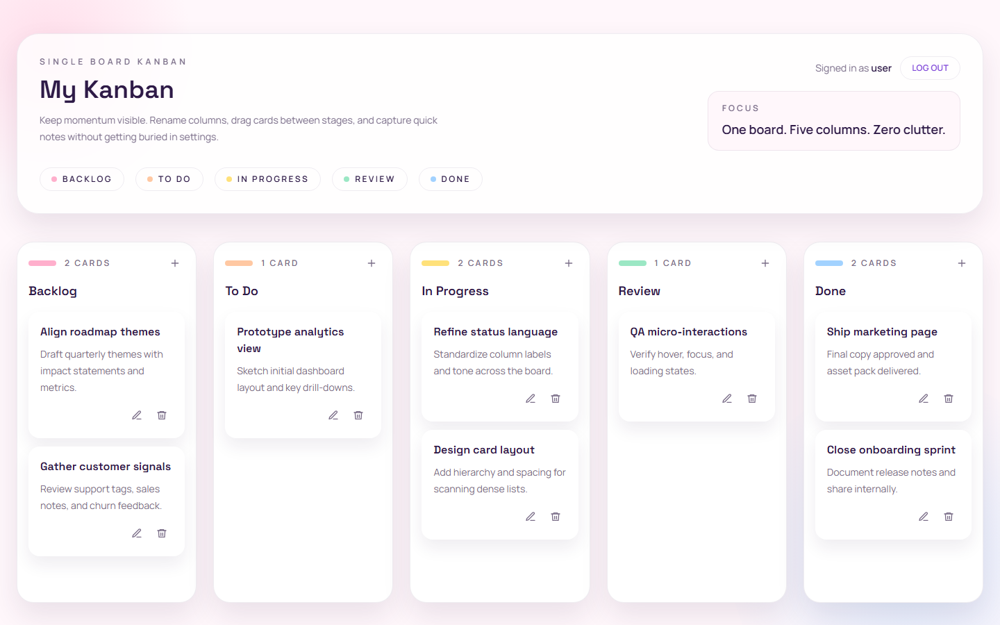

# My Kanban

A small project management app: sign up, and get your own Kanban board with five renamable columns and cards you can add, edit and drag between them.

Live demo: https://ingrid-kanban.onrender.com (sign in with `user` / `password`)

- It runs on the Render free plan, so the first visit after a while idle takes a little longer while the server wakes up.
- Data is reset on every restart or deploy: accounts created there do not last, and the demo board goes back to its sample cards. The demo account is shared by every visitor.



## Stack

- Frontend: Next.js (App Router, static export), React, Tailwind CSS, dnd-kit for drag and drop
- Backend: Python FastAPI, which serves the API under `/api` and the exported frontend at `/`
- Database: SQLite, with the board stored as JSON per user (see [docs/DATABASE.md](docs/DATABASE.md))
- Auth: sign up and sign in with scrypt-hashed passwords and an HttpOnly session cookie
- Everything runs in one Docker container

## Run locally

Requires Docker.

```bash
scripts/start.sh     # Mac / Linux; scripts/start.ps1 on Windows
scripts/stop.sh      # scripts/stop.ps1 on Windows
```

The app runs at http://localhost:8000. Data is kept on the `my-kanban-data` Docker volume.

## Tests

```bash
docker build -t my-kanban . && docker run --rm my-kanban pytest   # backend (pytest, inside the container)

cd frontend && npm install
npm run test:unit    # unit tests (Vitest, Testing Library)
npx playwright install chromium   # once, for the e2e tests
npm run test:e2e     # end-to-end tests (Playwright), against the app on localhost:8000
```

## Deploy

`render.yaml` is a Render Blueprint. In the Render dashboard, create a Blueprint from this GitHub repo; every push to `main` deploys.

## How it was built

The project was built in parts, each with a checklist, tests and success criteria: see [docs/PLAN.md](docs/PLAN.md). `AGENTS.md` holds the requirements and coding standards, and each folder (`backend/`, `frontend/`, `scripts/`) has an `AGENTS.md` describing its code.
